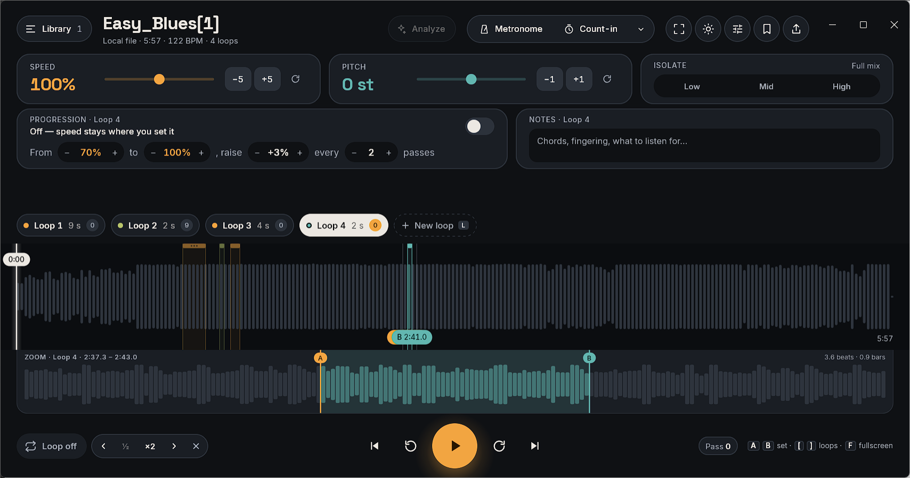
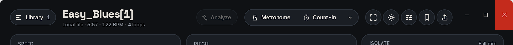
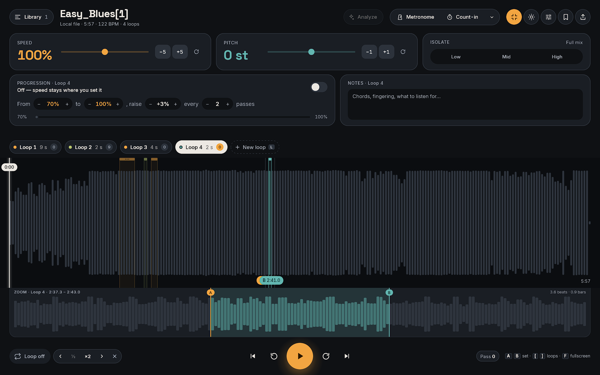
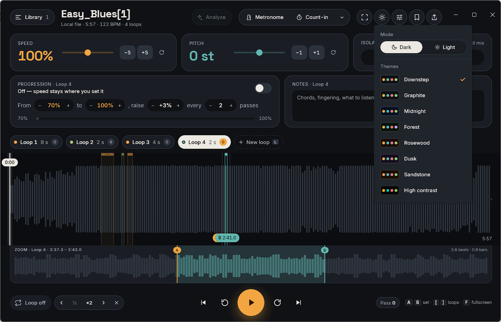
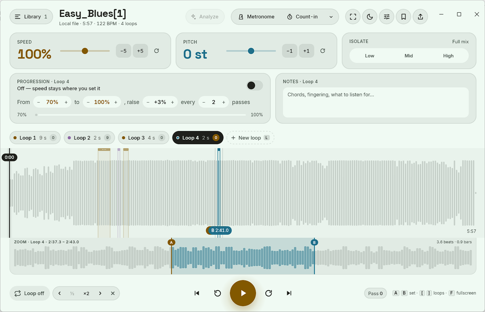
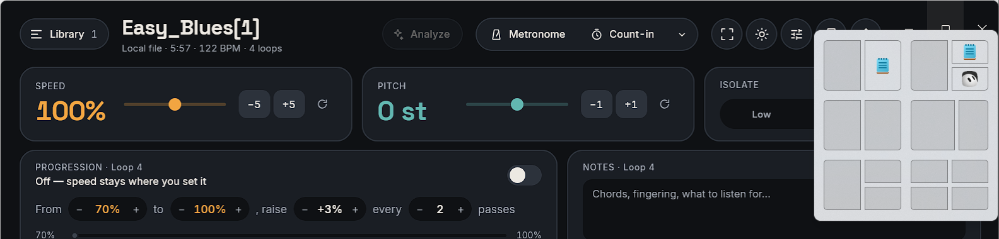
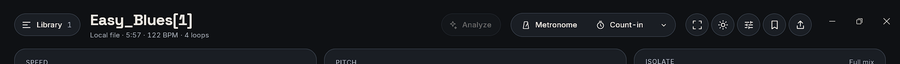
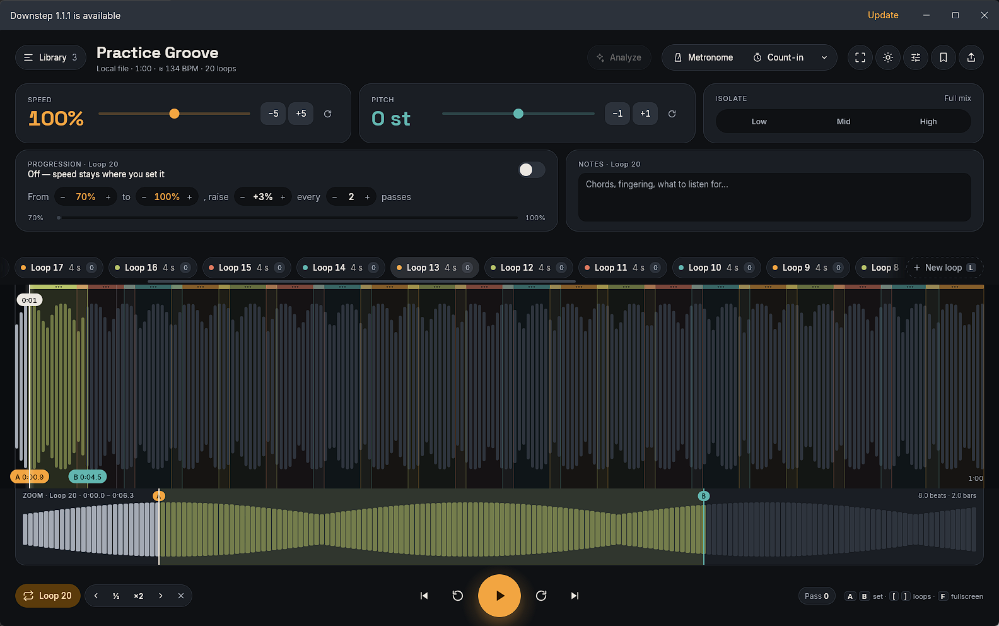
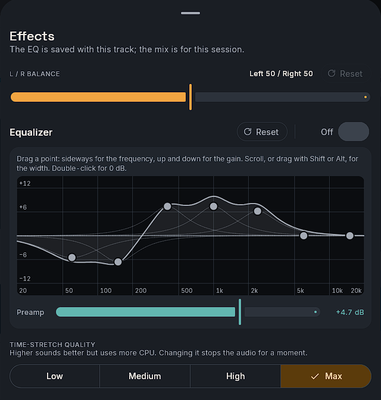

# Downstep 2.0 — Player redesign handoff

Prototype of the redesigned Downstep player (practice / transcription: speed, pitch, loops).
Built from the current app's theme (`Color.kt`, `Type.kt`), fonts and app icon in this repository.

```
handoff/
  README.md                 this document
  prototype/                clickable prototype — open "Downstep Player v3.dc.html" in a browser
  screenshots/              every section and behaviour, 1280px layout, dark + light
  assets/
    (fonts)                 Inter 400/500/600, Space Grotesk 500/700 (OFL): not copied here, they live once in
                            shared-ui/src/commonMain/composeResources/font/ (the prototype loads them from there)
    icons/                  downstep-app-icon.svg (replaces the Java coffee-cup in the title bar)
    palette.json            all colours, type, radii and control sizes used
```

The prototype simulates audio: the playhead advances in real time at the chosen speed, loops wrap, passes count,
progression ramps the speed. Nothing is actually heard. Isolate, Metronome, Count‑in, Save preset, Export are visual states only.
(In the app the Metronome and Count‑in click for real: see §7.5.)

---

## 1. Design principles

1. **The waveform is the instrument.** It spans the full window width with no card around it; everything else is
   secondary and sits above or below it. A second, zoomed waveform shows the active loop at sub‑beat precision.
2. **Loops are first‑class objects.** A track owns many named loops. They are visible everywhere at once — as colour
   regions on the waveform, as chips above it, and as the subject of the tools below it.
3. **Library is a drawer, not a sidebar.** It appears on demand and never takes width from the waveform.
4. **Actions are labelled.** Every top action is an icon *plus* a word (Metronome, Count‑in, Analyze) or a
   standard, well‑known icon with a tooltip (theme, fullscreen, save, export). No ambiguous icon rows. (App: on a
   narrow header Analyze, Metronome and Count‑in drop their words and keep the tooltip, §2.2.)
5. **Two accents only.** Amber = speed / loop start (A) / primary action. Teal = pitch / loop end (B) / isolate.
   Everything else is a neutral surface scale.
6. **Pills for state, cards for settings.** Toggles and chips are 999px pills; settings groups are 20px‑radius cards.

### Colour (see `assets/palette.json`)

| Role | Dark | Light |
|---|---|---|
| Background / waveform ground | `#0F1114` / `#0B0D10` | `#FAF6F0` / `#F4EEE5` |
| Surface 1‑4 (cards → hover → borders → strongest) | `#1A1E24 #20252C #2C323B #3B424C` | `#EEE7DC #E6DED1 #DDD4C6 #D3CABD` |
| Text / secondary text | `#ECE8E2` / `#A4AAB4` | `#1C1B19` / `#5E5A54` |
| Amber (speed, A, play, loop‑on) | `#F2A541` on `#2A1800` | `#935100` on white (hover `#7B4200`) |
| Teal (pitch, B, isolate) | `#62B6B0` on `#00201E` | `#23746F` on white |
| Loop colours (cycled by loop id) | amber, teal, coral `#E07A5F`, olive `#B8C46A` | `#935100 #23746F #B0533A #3F7A5A` |

Light mode is the existing Downstep light palette; dark is the existing dark palette. The theme toggle (sun/moon,
header) persists in `localStorage`.

(App: the light amber, amber hover and teal are darkened from the prototype's `#A86400`, `#8F5500` and `#2D7C77`, the
least that makes them WCAG AA as small text where the UI draws them; the dark palette is the design's, token for
token. This palette is the **Downstep** theme, the default of eight; `palette.json` has all of them, §7.8.)

### Type

- **Space Grotesk 700** — track title (26px), large read‑outs (speed 34px, pitch 34px, focus read‑outs 18px), drawer title.
  (App: no focus read‑outs, §4.9; speed and pitch drop to 26sp in the compact cards, §7.7.)
- **Inter 400/500/600** — all UI text. 13px controls, 12px meta, 11px uppercase section labels with 0.6px tracking.
- Tabular numerals everywhere (`font-feature-settings: 'tnum'`) so timecodes and percentages do not jitter.

### Spacing & sizes

24px page gutter. Header controls 40px tall; chips 34px; waveform 200px (260px in focus); zoom strip 96px;
play 68px; transport buttons 44px; loop‑tool buttons 30px. Minimum hit target in the transport is 44px.
(App: there is no focus mode. The overview's height follows the window, 120–260 dp in a window and up to 640 dp
on a full screen, the zoom strip 64–200 dp: §7.7.)

---

## 2. Anatomy, top to bottom


The sections below follow the prototype, top to bottom. **The app orders the player differently** (§7.7): the
header (§2.2) stays on top; the cards fill the middle, Speed · Pitch · Isolate (§2.7) then Progression · Notes (§2.8);
and the practice controls are pinned to the bottom, in this order: loop chips (§2.3) → overview waveform (§2.4) →
zoom strip (§2.5) → transport (§2.6). The controls never move; when the window is short the overview, the cards'
padding and the zoom strip give way first, and only as a last resort the cards scroll. Spare height on a tall
window goes to the waveforms, then sits between the cards and the controls.



### 2.1 Title bar
OS‑style strip with the real Downstep icon (`assets/icons/downstep-app-icon.svg`) and version.

(App: there is no separate strip anywhere. Per OS:
- **Windows:** the header is the title bar. Its empty area drags the window; a double click maximizes or restores,
  a right click opens the system menu, Aero Snap works, and hovering the maximize button shows Windows 11's snap
  layouts. Its right end has the window's own minimize, maximize / restore and close buttons, 46 dp wide and as
  tall as the header, drawn in the theme's colours: a light wash on hover, **red `#C42B1C` with a white glyph on
  close**, dimmer glyphs while the window is inactive. The window keeps its native frame: shadow, rounded corners,
  resize borders (the top one is inside the header, a strip as thick as the system's border). When a banner (no
  audio output, an update) shows above the header, the banner is the window's top and carries the buttons; the
  header below still drags the window. In fullscreen the buttons go and the header keeps its gutter. If the title bar
  cannot be replaced, and on the "engine not available" screen, Windows' own title bar stays. Details: §7.10.
- **macOS:** the title bar is transparent over the content, with only the traffic lights; the content starts 28 dp
  lower to leave them room (none in fullscreen). The green button enters native fullscreen, as F does (§4.9).
- **Linux:** the system title bar, as before.

The title "Downstep <version>" is still set on every OS, for the taskbar, Alt+Tab and screen readers.)



### 2.2 Header
- **Library** pill (left) with track count → opens the drawer.
- **Track title** + meta line: source · duration · detected BPM · loop count. (App: "≈ 92 BPM" when detected, "92 BPM"
  when typed or tapped, "BPM …" while the first analysis runs; click to change it. §7.5.)
- **Analyze** pill → section detection (see §4.8). Label becomes *Analyzing…* then *Re‑analyze*.
- **Metronome / Count‑in** segmented pill; each is an independent amber‑filled toggle. (App: a ⌄ at its end opens the
  click volume, the count‑in length and "Count in at every loop restart". §7.5.)
- Icon buttons: **Focus** (⤢), **Theme** (☀/☾), **Save preset** (bookmark), **Export** (↑; full track, loops or
  both, see §7.3). (App: **Fullscreen** replaces Focus, §4.9; **Theme** opens the theme menu, §4.12; an
  **Equalizer** icon opens the effects sheet, §7.4; on Windows the window buttons follow, §2.1.)

**Compaction (app).** The header's content has the window's width less the two gutters and, on Windows, the window
buttons (3 × 46 dp). Below **900 dp** of that room, Analyze and the Metronome / Count‑in toggles show their icons
only; their names stay in the tooltips and for screen readers. The design's 1280 dp window has 1232 dp, so it shows
the words; the minimum 1000 dp window has 952 dp, or 826 dp beside Windows' buttons, so on Windows it shows icons.
Short of room, the rest of the meta line shortens around the BPM, which always stays whole: it is the only way to the
BPM dialog. The choice follows the header's measured width (a resize), never a frame.

### 2.3 Loop chips strip
One chip per loop, in time order: colour dot · name · length · **pass badge**. The active chip is inverted
(light fill on dark, dark fill on light) with an amber pass badge. Suggested loops from Analyze appear as
dashed amber chips with ✓ / ✕. The strip ends with a dashed **+ New loop `L`** chip. Scrolls horizontally when long,
also with the plain wheel, with the active chip kept in view and *+ New loop* pinned (§7.12).
A double click on a chip renames the loop in place (see §7.2).

### 2.4 Overview waveform (full width)
- Bars: played = light grey, unplayed = dark grey; inside the active loop they take the loop colour (played solid, unplayed 50%).
- Every loop draws a tinted region, a 7px rounded **top bar** (a grab handle with three grip dots; it grows to 11px
  and turns opaque under the mouse or in a drag) and 1px edge lines in its colour; the active one is brighter.
  Any loop's bar and edges can be dragged (§3, §7.2).
- No bar or beat lines: loop edges are free (Snap to beat was removed after 2.0, see §7.1).
- **A / B pills** at the bottom with timecodes to 0.1s; a faint bracket shows the zoom window.
- **Playhead**: 2px line with a glow and a floating timecode pill at the top, just under the loops' top bars.
- Dashed amber outlines + labels for Analyze suggestions.

### 2.5 Zoom strip
Attached under the overview, inset to the gutter. Shows the active loop plus ~35% padding each side (minimum 4 beats).
No beat lines. Header text: `ZOOM · <loop> · <window from–to>` and `<n> beats · <n> bars` for the loop
(the length in seconds without a BPM). A/B lines are draggable here, freely, as on the overview. A drag on the
overview (an edge or the whole loop) is drawn here live as well; the window re‑frames when the drag is dropped.

### 2.6 Transport row
- **Left:** loop toggle pill (amber when looping, shows the active loop name or *Loop off*) · active‑loop tool
  group (◀ nudge · ½ · ×2 · nudge ▶ · ✕ delete). (The *Snap to beat* toggle that followed it was removed, §7.1.)
- **Centre:** ⏮ to start · ↺ −5s · **Play/Pause** · ↻ +5s · ⏭ next loop.
- **Right:** **Pass** counter pill (`Pass 4 · +3% in 2` while progression is on) · keyboard hints (`A B set · [ ] loops · F focus`).
  In focus mode the hints are replaced by large speed and pitch read‑outs. (App: the hint reads `F fullscreen`, and
  the hints show only on a window at least 1180 dp wide; there are no read‑outs here, §4.9.)

### 2.7 Speed · Pitch · Isolate cards
- **Speed** 25–200%, slider, −5/+5, reset. Amber read‑out.
- **Pitch** −12…+12 semitones, slider, −1/+1, reset. Teal read‑out.
- **Isolate** Low / Mid / High solo toggles (teal when on). Label reads *Full mix* or e.g. *Low + Mid only*.

### 2.8 Progression · Notes cards (per active loop)
- **Progression**: on/off switch; one sentence of pill‑steppers — *From 70% to 100%, raise +3% every 2 passes*;
  status line (*Off — speed stays where you set it* / *Now 76% · next +3% in 1 pass* / *At target — 100%*);
  a thin from→to progress track.
- **Notes**: free text saved with the loop (chords, fingering, what to listen for).

### 2.9 Library drawer
360px panel sliding over the left edge with a scrim. Title, search, close; Tracks / Playlists segmented pill;
list with artwork tile, title, meta (source · loop count); the current track is highlighted amber. Full‑width amber **Import** button at the bottom.


---

## 3. Interaction model

### Pointer
| Target | Gesture | Result |
|---|---|---|
| Overview waveform | click inside the looping loop | seek there, keep looping |
| Overview waveform | click anywhere else (another loop's body too) | Loop off, seek there; playing or paused stays as it was |
| Loop top bar (overview) | click (no drag) | play this loop: active, Loop on, from its A, playing (on the loop already being looped: seek within it, playing or paused as it was) |
| Loop top bar (overview) | drag | move the whole loop, keeping its length, clamped to the track; a loop that is not active becomes active |
| Zoom waveform | click | seek playhead |
| A or B line (either waveform; any loop on the overview) | drag | move loop edge freely (no beat grid); A can't cross B (min 0.5% apart, at least 1 s); a loop that is not active becomes active |
| Loop chip | click | make active, jump playhead to its start, loop on |
| Loop chip | double‑click | rename in place: Enter or clicking away saves, Esc cancels, an empty name keeps the old one |
| Suggested chip ✓ / ✕ | click | accept (becomes a real loop, active) / dismiss |
| ½ / ×2 | click | halve / double the loop keeping A fixed |
| ◀ ▶ nudge | click | shift the whole loop by a fixed 1 s of track time |
| ✕ in tool group | click | delete active loop; the first remaining loop becomes active |
| Progression steppers | click | ±5% (from/to), ±1% (step), ±1 (every) |

### Keyboard (ignored while typing: Notes, BPM, a loop's name, search)
| Key | Action |
|---|---|
| `Space` | play / pause |
| `L` | new loop starting exactly at the playhead (8 beats long with a BPM, else 8 s) |
| `Shift+L` | loop on / off |
| `A` / `B` | set active loop's start / end exactly at the playhead |
| `[` / `]` | previous / next loop (jumps to its start) |
| `←` / `→` | seek −5 s / +5 s |
| `F` | focus mode on / off (app: fullscreen on / off, §4.9) |
| `F11` | (app) fullscreen on / off, even while typing |
| `Esc` | close drawer, exit focus (app: closes the drawer, then a menu, dialog or sheet; only an Esc nothing else takes leaves fullscreen) |

### State feedback
- Active loop: inverted chip, brighter region, visible A/B pills, tool group enabled, zoom strip follows it.
- Playing: play icon ↔ pause icon; playhead and timecode pill move; passes tick up at every wrap.
- Toggles (Metronome, Count‑in, Loop, Isolate, Progression) fill with their accent when on.
- Suggestions are always dashed until accepted — the app never commits loops on the user's behalf.

---

## 4. Functionalities

### 4.1 Multiple named loops
Each loop = `{ name, start, end, passes, notes }`, stored with the track, sorted by start time, coloured by id.
Any number per track. One is *active*: it is the one that wraps playback, gets edited, zoomed and counted.

### 4.2 Looping
When *Loop* is on and the playhead reaches B, it jumps to A and the loop's **pass counter** increments.
*Loop off* keeps the loop defined but plays through.

### 4.3 Speed and pitch
Independent; speed 25–200% in 5% steps, pitch ±12 semitones. The transport simulation advances in proportion to speed.

### 4.4 Snap to beat (removed after 2.0)
The prototype quantised A/B set/drag, new loops and nudges to a beat grid and drew bar lines while *Snap to beat*
was on. The app no longer has it: loop edges are always free, nudges are a fixed 1 s and no grid lines are drawn.
The BPM still sets the length of a new loop (8 beats), the zoom padding (4 beats) and the beat count. See §7.1.

### 4.5 Zoom strip
Derived view, no separate zoom control: window = active loop ± max(35% of its length, 4 beats). Changing the loop
re‑frames it automatically.

### 4.6 Pass counter and Progression
A pass is counted every time the active loop wraps during playback (no judgement of quality — see note below).
Progression, when on, sets speed to *From* and raises it by *Step* every *Every* passes until *Target*; the
transport pill shows *+3% in N*, and the card's status/progress bar reflect where you are.
> Recommendation for the real app: reset the pass counter if the user intervenes mid‑pass (seek, A/B change, speed/pitch change, pause) so "passes" means uninterrupted passes.

### 4.7 Isolate
Band solo (Low / Mid / High) — any combination; none selected = full mix. Visual only in the prototype; in the app
it is a fixed stage after the EQ (see 7.4).

### 4.8 Analyze (suggested loops)
Simulates ~1.6s of analysis then proposes sections (Verse 1, Chorus, Bridge) as dashed chips and dashed outlines
on the waveform. Accept turns one into a normal loop and makes it active; dismiss removes it. *Re‑analyze* repeats.
Intended backend: section/beat detection model; an LLM only for naming. Never auto‑commit.

### 4.9 Fullscreen (replaces Focus mode)
The prototype's Focus mode (header, chips and cards hidden, a compact title with *Exit focus*, a 260px waveform and
big speed/pitch read‑outs) **is not in the app**. The header's Focus button is a **Fullscreen** toggle instead: the
same player, over the whole screen, which the fitted layout (§7.7) fills with taller waveforms.
- **Toggle:** the header icon (enter / exit icons, filled amber while on; tooltips "Fullscreen (F)" and "Exit
  fullscreen (Esc)"), `F`, or `F11` (even while typing). `Esc` leaves it, but only after it has closed the drawer, a
  menu, a dialog or a sheet; a focused text field keeps its Esc too. macOS also has Window › Enter Full Screen
  (⌃⌘F) and the green button, which toggle the same thing.
- **Per OS:** on Windows a borderless window over its whole monitor, taskbar included, as a browser's F11 (another
  window coming in front never minimizes it); on macOS native fullscreen in its own Space; on Linux AWT's
  full‑screen window.
- **Layout:** the same as in a window; past the design's height the overview grows up to 640 dp and the zoom strip
  up to 200 dp, so a full screen gets taller waveforms without scrolling.
- **Not saved:** leaving goes back to the window as it was (floating or maximized), and the next run never starts
  in fullscreen.

See §7.9.



### 4.10 Notes
Per‑loop free text, persisted with the loop, shown for the active loop.

### 4.11 Library
Tracks and playlists in a drawer; selecting a track loads it (loops are per track), closes the drawer. Import at the bottom.

### 4.12 Theme
Dark (default) and light, toggled from the header, persisted.

(App: the header's theme button (sun or moon, the mode on screen) opens a **theme menu**:
- a **Mode** pill, Dark / Light, the chosen half inverted (fg filled, as the active loop chip);
- **Themes**: Downstep (the default), Graphite, Midnight, Forest, Rosewood, Dusk, Sandstone and High contrast, each
  with a swatch (the theme's background with its primary, secondary and two other loop colours as dots, in the mode
  on screen), its name and a check on the chosen one.

Hovering an item, or moving the keyboard focus onto it, **previews** it across the whole app at once; leaving the
menu, Esc or closing it goes back to the chosen theme. A click, or Enter or Space on what is previewed, **applies and
saves** it. Picking a theme closes the menu; picking a mode keeps it open so a theme can follow. Every theme exists
in dark and light, all at WCAG AA. §7.8.)



---

## 5. Screenshot index

| File | What it shows |
|---|---|
| `01-player-dark.png` | Default state, dark, Solo loop active |
| `02-player-light.png` | Same in light theme |
| `05-library-tracks.png` | Library drawer, Tracks tab |
| `06-library-playlists.png` | Library drawer, Playlists tab |
| `07-analyze-running.png` | Analyze in progress (header label *Analyzing…*) |
| `08-analyze-suggestions.png` | Three dashed suggestions on chips and waveform |
| `09-suggestion-accepted.png` | Chorus accepted → real loop; Verse dismissed |
| `10-progression-isolate-metronome.png` | Progression on (speed snapped to 70%), Low isolated, Metronome + Count‑in on |
| `11-playing-passes-ramp.png` | Playing; pause icon, pass pill with ramp hint, moved playhead |
| `12-loop-off-snap-off.png` | Loop off, Snap off (no grid lines). Predates §7.1: the app has no Snap toggle any more |
| `13-new-loop-added.png` | `L` pressed → "Loop 5" (8 beats) created at playhead and active |
| `14-loop-halved.png` | ½ applied → 4 beats, zoom re‑framed |

The prototype's focus‑mode screenshots (`03`, `04`) were dropped with focus mode (§4.9). Screenshots of the app
after 2.0, from the Windows app, are listed in §7.11; the ones for the layout, themes, fullscreen and title bar:

| File | What it shows |
|---|---|
| `fit-1280x720.png`, `fit-1366x768.png`, `fit-1920x1080.png` | The largest window that fits each screen less a 48 px taskbar: controls at the bottom, nothing scrolls (§7.7) |
| `fit-minimum.png` | The minimum window (1000 × 600 dp, 1234 × 742 px visible): the most compact layout, icon‑only header (§2.2, §7.7) |
| `fullscreen.png` | Fullscreen: the same layout with taller waveforms (§4.9, §7.9) |
| `theme-menu-open.png` | The theme menu: Dark / Light and the eight themes (§4.12) |
| `theme-preview-<id>-dark.png`, `theme-preview-<id>-light.png` | Menu open, Midnight, Forest or Sandstone hovered and previewed, in each mode (§7.8) |
| `theme-forest-light.png` | Forest applied, light mode (§7.8) |
| `titlebar-buttons-hover.png` | Windows: the header as the title bar, close hovered red (§2.1, §7.10) |
| `titlebar-snap-layouts.png` | Windows 11's snap layouts over our maximize button (§7.10) |
| `titlebar-maximized.png` | Maximized: the header at the screen's top, the restore glyph (§7.10) |

---

## 6. Not in scope / open
- Spotify / Apple Music import (DRM prevents time‑stretch; dropped by decision).
- Real audio engine, EQ, export formats, preset contents. (The metronome click and the count‑in were added after 2.0:
  §7.5.)
- Mic‑based "clean pass" scoring.
- Responsive behaviour below ~1000px (cards would need to stack). (App: the window's minimum is 1000 × 600 dp, or the
  screen's usable area where that is smaller; on a screen that small the header compacts, §2.2, and the cards may
  scroll.)

Open in the app (§7.7–§7.10), checked by tests and on one Windows 11 machine (one 1920×1200 monitor at 125%) only:
- **No second‑monitor hand test.** Restoring the window onto the screen that shows most of it, the minimum size from
  the screen it opens on, and fullscreen following its window to another monitor (Win+Shift+arrows) or a display
  change are covered by unit tests (`WindowBoundsTest`, `FullscreenBoundsTest`), not by hand on two monitors or two
  scales.
- **Auto‑hide taskbar only unit‑tested.** A maximized window leaves 2 px free on the edge where an auto‑hide taskbar
  waits, so it can still slide out (`CaptionlessFrameTest`); not tried on a real auto‑hide taskbar.
- **Aero Shake not tested.** Shaking the window by its header should minimize the others as with a system title bar
  (the header answers HTCAPTION); it was not tried.
- **Windows 10 not tried.** The hook reads the resize border at the system DPI before Windows 10 1607, and Windows 10
  has no snap layouts flyout; only Windows 11 was used.
- **macOS and Linux** fullscreen and title bars are covered by the tests; the screenshots of this round are from
  Windows only.
- **The minimum size drag not tried by hand after its fix.** The window reports 1250 × 750 px as its smallest drag
  size at 125% (`WM_GETMINMAXINFO`, §7.10), which Windows' own resize loop holds; a drag of the border could not be
  sent from the automation used here. Without the hook (fallback, error screen) AWT's minimum stays in pixels.

---

## 7. Changes after 2.0

What the app does differently from the sections above since the 2.0 handoff. The prototype and the screenshots are
kept as they were (they are the record of the design); where they disagree with this section, this section wins.

### 7.1 Snap to beat removed, play icon centred

**Snap to beat is gone**, with its toggle, its tooltip and its per‑track setting:
- A/B set (`A` / `B`), A/B drag on both waveforms, `L`, ½ and ×2 are free: positions are kept exactly where the
  playhead or the pointer is, never rounded to a beat. A still can't cross B (min 0.5% apart, at least 1 s).
- **◀ ▶ nudge moves the loop by a fixed 1 s of track time** (`LoopMath.NUDGE_SECONDS`), whatever the BPM, the speed
  or the track length: finer than the ±5 s seek, and the same step every time. Tooltips say "1 s".
- No bar lines on the overview and no beat lines on the zoom strip: the grid was anchored at 0 s with no
  downbeat, so on most songs it was off the real beats.
- The BPM is kept: it still sets the length of a new loop (8 beats; 8 s without one), the zoom padding (4 beats) and
  the `<n> beats · <n> bars` header, and it is the tempo of the metronome and count‑in.
- Storage: database version 3 drops `track_practice_state.snap_to_beat` (the table is rebuilt, which works on every
  SQLite) and adds the columns later features use (`eq_curve`, `detected_bpm`, `beat_offset_seconds`,
  `tempo_analysis_version`, and `practice_presets.eq_curve`). Backups no longer write `snapToBeat`; older backups
  that have it still restore (the key is ignored).

**The play icon is optically centred** in the round Play button (68 dp, 28 dp icon), in both themes and in focus
mode. The triangle's centroid, not its bounding box, now sits on the button's centre: `ic_h_play` is
`M8.3333 5v14l11-7z` (was `M10.5 5v14l11-7z`), so its vertices' mean is (12, 12) in the 24‑unit viewport. Before, the
centroid was 2.17 units (2.5 dp) right of centre; the bounding box now leans 1.83 units right, which is the optical
compensation. `PlayerRenderTest` measures the rendered icon's ink centroid against the button in the dark, light
and focus renders (within 0.6 dp; it measured 2.52 dp off before the change).

### 7.2 Loops edited on the overview, renamed in their chip

**Every loop on the overview is directly editable**, not only the active one:
- Each loop has a **top bar** (7px, rounded, three grip dots) instead of the 3px rule. Its grab zone is the top 16px
  of the waveform over the loop. Under the mouse the bar grows to 11px and turns opaque, and the cursor becomes a
  move cursor; over an edge (8px each side, any height) it is a horizontal‑resize cursor; elsewhere the crosshair.
- **Dragging the top bar moves the whole loop** by the pointer's travel, keeping its length; it stops at the start
  and end of the track. **Dragging an edge resizes** it; A can't cross B (the usual minimum length).
- Grabbing a loop that is not active makes it active as the drag starts, where the playhead is and with Loop on or
  off as it was. With Loop on the engine then loops the grabbed loop, so a playhead outside it goes to its A: you
  hear the loop you are editing. The zoom strip follows it and draws the drag live; its window re‑frames on drop.
- Where loops overlap, the active one is grabbed first, then the shortest; on a loop too narrow for a bar and two
  edges, the middle third is the bar.
- The drag is drawn locally and committed once on release, through the same use case as the A/B keys; the loop is
  saved at once and the practice state (the engine's region) by the debounced auto‑save.

**Click or drag**: a press that travels more than 4 dp sideways (a finger: the platform's touch slop) is a drag;
less is a click. On the overview a click means:
- inside the loop being looped: seek there, keep looping;
- anywhere else, including another loop's body below its top bar: **Loop off** and seek there (the loop stays
  selected); playback goes on if it was playing and stays paused if it was paused;
- on a loop's **top bar**: *play this loop*: it becomes active, Loop on, the playhead jumps to its A and playback
  starts (also when paused). On the loop that is already being looped it is a click inside it: seek there, and
  playing or paused stays as it was (when paused, only another loop's bar starts playback). This holds over the
  whole drawn bar, its ends too, where a drag would resize the loop: there the edge wins only for a drag;
- on an edge of the active loop below its top bar (or just outside it): a seek kept inside the loop (a click just
  outside B does not turn the loop off); on another loop's edge there, a click like any other.

**Rename in place**: a double click on a loop chip (or *Rename* in its menu) turns the name into a text field with
the name selected. Enter or clicking away saves (trimmed, at most 40 characters), Esc cancels, and an empty or
unchanged name keeps the old one. The first click of the double click still selects the loop. While the field has
the focus the window's shortcuts are off, so Space, `L`, `A`, `B`, `F` and Esc go to the field. The rename dialog is
gone.

### 7.3 Export: full track, loops or both

The header's **Export** icon opens an options dialog before anything renders: **Full track** (the default, and
the only choice on a track without loops), **Loops, one file each** or **Full track and loops**. Each row says how
many files it writes; the loop rows are disabled with "This track has no loops yet" when there are none. The last
choice is offered again until the app quits.
- **Files.** All MP3, as before. The full track keeps its name, `<track> <speed>%[ ±<n>st].mp3`. Each loop is
  `<track> - <nn> <loop name>.mp3`: `nn` is the loop's place in the chip strip's order (by start), 1-based, with
  two digits (three past 99 loops), so a folder sorted by name lists the loops in musical order and two loops with
  the same name never collide. Names are made safe for Windows, macOS and Linux (`\ / : * ? " < > |` and control
  characters become `_`, line breaks and runs of spaces become one space, trimmed, no leading dot (a hidden file)
  and no trailing dot, the title capped
  at 80 characters and the loop name at 40), and a name that still repeats another, ignoring case, gets " (2)".
- **Sound.** A loop file is its A→B slice with exactly the full export's processing: speed, pitch, L/R mix, EQ
  curve and preamp. It starts at A itself (the time stretcher's run-in before A is dropped), lasts (B − A) / speed,
  starts with the player's 10 ms fade-in and ends with a 10 ms fade-out, so the cut never clicks. The sound
  settings are taken once, when the batch starts (`sd_export_capture_settings`): an EQ or mix change made while it
  runs reaches none of its files, so every file of a batch sounds the same. The engine renders every file of the
  batch from the one decoded buffer already in memory (`sd_export_begin_range_with`): nothing is decoded again.
- **Not exported, by decision:** the metronome, the count-in and Isolate. They are practice aids, not part of the
  music: a click or a count-in baked into a file cannot be taken out again, and a count-in would move A away from
  the start of a loop file. The dialog says so.
- **Progress and cancel.** One banner for the whole batch ("Exporting 4 files to MP3… 42%") with one bar, weighted by
  each file's length so it moves evenly from the first file to the last, and one Cancel. Cancelling, or any failure,
  deletes every file of the batch, including a file cut short by a failed write (a full disk): it is all or nothing.
- **Result.** One file: as before, *Save…* (a save-as dialog) and *Share* (shows it in the file manager). Several:
  the dialog lists the first five names, and *Save to folder…* opens a folder picker; every file is copied there,
  next to the others, and a file already in that folder is never replaced (the copy gets " (2)"). *Share* shows the
  batch in the file manager.

### 7.4 Bell-curve EQ, saved per track

The effects sheet's seven gain sliders are replaced by a **frequency-response graph** (`EqGraph`), the only EQ
editor. §6 lists the EQ as outside the prototype; this is its design.

- **Axes:** frequency on a log axis, 20 Hz to 20 kHz (grid at 20, 50, 100 … 10k, 20k); gain linear, ±15 dB shown,
  grid every 6 dB with 0 dB stronger. The plot sits on `bgDeep` inside the sheet's `surfaceContainer` card, radius
  `control` (10).
- **Bands:** each one is a peaking (bell) filter with a node. The starting layout is seven bands at 60, 150, 400,
  1k, 2.4k, 6k and 15k Hz, Q 1, flat; there is room for eight (`EqCurve.MAX_BANDS`, the engine's
  `SD_EQ_MAX_BANDS`). Gain ±12 dB, frequency 20 Hz–20 kHz, Q 0.3–10, all clamped.
- **Gestures** (common code, also for Android): drag a node sideways for the frequency, up and down for the gain;
  the **wheel over a node** or a **drag with Shift or Alt** changes the width (Q: four wheel notches or 60 dp of
  drag double or halve it; up is wider). **Double-click a node** to put its gain back to 0 dB. The pointer is a
  hand over a node; presses on a node are consumed, so the sheet neither scrolls nor closes under a drag.
- **Drawing:** the combined curve bold in amber with a light fill to 0 dB, each band's own bell faintly; the node
  under the pointer (or dragged) turns teal and is read out above the plot (`1.2 kHz · +3.5 dB · Q 1.4`); without
  one the line shows the gesture hint. With the EQ off the curve and nodes are drawn in `fg2`. The curve comes from
  `EqResponse`, the same RBJ formula the engine runs, so what is drawn is what is heard.
- **Kept:** the EQ switch, Reset (back to the starting layout, flat; on/off stays; a button of its own since §7.12), the preamp slider (±12 dB) and
  the time-stretch quality.
- **Engine:** RBJ peaking biquads (`Biquad.h`, `Equalizer.h`). Changes reach the audio thread lock-free (a seqlock:
  one band's frequency, gain and Q always arrive together) and **glide**: the parameters move once per 32-frame
  sub-block with a ~20 ms time constant (ending within ~80 ms), the preamp ramps sample by sample, and on/off
  glides too, so dragging a node never zippers or clicks. Settled at flat, the EQ is skipped (bit-transparent).
  While stopped, changes apply at once, so a new player (the export's) starts with the EQ in place.
- **Isolate** keeps working, now as a fixed stage after the EQ (`Isolation.h`): the first EQ's 7-band split with
  everything outside the selection cut 12 dB, whatever the user's bands are and whether the EQ is on. It glides like
  the EQ and is never saved.
- **Saved per track:** an edit is saved (after a 500 ms pause) with the track it was made on
  (`track_practice_state.eq_curve`, JSON); a track without its own plays the **global EQ** (the preferences), which
  is also what is edited when no track is open and the EQ of a track outside the library. Switching tracks loads the
  new track's EQ; an edit still waiting is saved to its own track first. Only a changed curve becomes the track's
  own: a quality change alone leaves a track on the global EQ. The sheet's subtitle says which one is being
  edited.
- **Presets** save the track's EQ with them (`practice_presets.eq_curve`); applying one makes it the track's EQ, as
  an edit would (also when applied while the track's EQ is still loading). Presets saved before keep no EQ and leave it alone.
- **Migration:** the first EQ's preferences (seven gains, preamp, switch) become the global curve on first read: the
  five middle bands map exactly (they were Q 1 bells); the end shelves become broad bells (Q 0.7) at 60 Hz and 15 kHz,
  which keep the gain at their frequency (below 60 Hz and above 15 kHz the old shelf held its gain where the bell
  returns to 0 dB). The next save writes `eq_curve` and removes the old keys. Tracks keep playing the migrated global
  EQ until edited. Backups carry the track's and each preset's EQ as optional fields (`eq`); older backups restore
  without them.
- **Export** carries the EQ and preamp as heard, never Isolate (a practice aid, like the loop).

### 7.5 Metronome and count‑in

**Both toggles now click for real** on desktop (the C++ engine), and are enabled; a platform without the engine still
shows them disabled with the "not available yet" tooltip.

- **Metronome:** a short click on every beat of the track's tempo grid, accented (higher, louder) on the first beat of
  each 4‑beat bar. It is mixed in the engine's render callback *after* the time stretch, EQ, preamp and fades, so it
  is never stretched, pitched or equalised; the output gain still applies. Each output frame knows the source position
  it plays (from Bungee's grain table, wrap‑aware), so the click lands on the beat to the sample, follows the speed,
  seeks and loop wraps: a loop that starts on a beat clicks on every wrap, one that starts between beats never does.
  It lines up with what is heard (the music's own run‑in after a seek included) within a millisecond at any speed.
- **Count‑in:** before playback starts, N clicks at the effective tempo (BPM × speed; 120 BPM × speed without a
  tempo), the first accented; the music starts from the requested position exactly one beat after the last click
  (sample‑exact: Bungee's run‑in is skipped so the position itself is on the beat). With **Count in at every loop
  restart**, playback stops at B (short fade), counts in again and goes on from A; the position stays at A meanwhile,
  a pass still counts once, and there is no end‑of‑track event. Pausing during a count‑in cancels it. A speed
  change during a count‑in (a Progression step lands just after the loop restarts) re‑times the clicks still to
  come and the music after them; the clicks already heard stay where they were.
- **Settings (⌄ menu):** click volume 0–100% (the count‑in's too; default 70%), count‑in length 2 / 4 / 8 beats
  (default 4 = one bar), every loop restart (default off). They are global, kept across launches (Java preferences
  node `com/damianogiusti/slowdowner/click`), like the toggles themselves.
- **Tempo:** detected from the audio the first time a track is opened, off the UI thread (onset‑energy envelope in
  5 ms hops, compressed so that a quiet hi‑hat counts less than the kick and snare, autocorrelation over 40–240 BPM with a preference near 120, then a comb over the whole track that fits the
  period and the first beat together; a tempo whose off‑beats are as strong as its beats is doubled up to 200 BPM). The
  result, "nothing found" included, is cached with the track (`detected_bpm`, `beat_offset_seconds`,
  `tempo_analysis_version`): a track is analysed once, again only when the analysis version goes up. Silence, noise,
  steady tones and tracks under 4 s give no tempo. Bars are not detected: beat 1 is the first beat found.
- **Typed or tapped BPM wins** over the detected one. The BPM dialog shows the detected tempo, has **Tap** (or T in the
  field; the average of the last 8 taps, a 2 s pause starts over) and **Use detected** (clears the user's BPM). After a
  typed or tapped tempo, the engine finds where its beats fall in the audio (the same analysis, tempo given), so the
  metronome lines up with the music. Turning the metronome on with no tempo at all asks for one.
- **Exports never contain the metronome or the count‑in** (full track and loop slices alike): they are practice aids,
  not part of the music, and a slice keeps the exact (B − A) / speed length. In the engine they are kept out of
  `Player::Settings`, which is all an export copies.
- Backups carry `detectedBpm` and `beatOffsetSeconds` (optional, older backups restore without them); a restored track
  is analysed again when first opened.

### 7.7 Controls at the bottom and a window that fits

**Order.** The header stays on top. The cards fill the middle: Speed · Pitch · Isolate, then Progression · Notes
(above the chips that name their loop). The practice controls are anchored to the bottom, always in this order: loop
chips → overview → zoom strip → transport. The loading bar and the export banner sit between the header and the
cards. The controls never move or scroll: the hand finds play and the loop tools in the same place at any window
size. Only the middle can scroll, and only as a last resort.

**Fit** (`PlayerLayoutFit`, a pure function of the player's size and of what shows; computed again on a resize,
never while it plays). The natural heights, measured on the real components (`PlayerPartHeights`): header 74 dp,
chips 56 (compact 44), overview 260 at the design's height, zoom strip 96, transport 96 (compact 80), Speed · Pitch ·
Isolate 115 (compact 87), Progression · Notes 142 (compact 95, plus 36 below 1240 dp of width, where the progression's
sentence wraps). When the player is shorter than the design, these give way in this order:
1. **The overview** shrinks, from 260 down to 160 dp.
2. **The cards** turn compact: less padding and a smaller read‑out (34 → 26 sp) for Speed · Pitch · Isolate,
   Progression without its track and a shorter Notes field. The overview stays at most 160 dp.
3. **The chrome:** less padding around the chips and the transport, the zoom strip down to 76 dp; the overview
   between 160 and 140 dp.
4. **The overview again** down to 120 dp, the zoom strip at 64 dp.
5. Only then do **the cards scroll**; the controls still do not.

A stage starts where the one before gave up, so the overview never grows as the window gets shorter (each 1 dp less
never makes it jump up). With an active loop (Progression · Notes showing) at a width of 1240 dp or more, stage 1
holds down to a player 739 dp tall, stage 2 to 664, stage 3 to 596 and stage 4 to 564; without a loop the 142 dp of
its cards go to the overview. The loading bar and the export banner are measured and left out of the room the fit
shares, so the cards do not scroll during a decode or an export. The keyboard hints beside the transport show only
from 1180 dp of width.

**Taller than the design** (a big window, a full screen): only an uncompressed layout grows. The overview takes 60%
of the room past the design's height, up to 640 dp, the zoom strip 25%, up to 200 dp; the rest stays between the
cards and the controls.

**Window size** (`WindowBounds.kt`; dp = AWT's units, the OS scale already applied):
- **Default** (first run, nothing saved): the design's **1280 × 820**, capped to **94%** of the primary screen's
  usable area (without the taskbar, Dock or menu bar), centred. On a screen just wide enough for a one‑line
  progression (1240 dp plus Windows' 16 dp of invisible side borders) the width margin gives way first, so a
  1280 × 720 screen still opens a one‑line player.
- **Minimum: 1000 × 600**, or the whole usable area of the screen the window opens on where that is smaller. At
  600 dp the most compact layout still shows every control; below 1240 dp of width the wrapped progression may make
  the cards scroll a little.
- **Saved:** position, size and maximized are saved (half a second after a move or resize) in the Java preferences
  node `com/damianogiusti/slowdowner/window`, and restored on the screen that shows most of the window, shrunk and
  moved to fit it; on a monitor that is gone it opens at the default, centred on the primary screen. A maximized
  window keeps the size it restores to. Fullscreen is never saved (§7.9).

**Verified** by `PlayerLayoutRenderTest` (every control on screen, nothing scrolls, under the real Windows frame):
maximized and default windows on 1280 × 720, 1366 × 768 and 1920 × 1080 screens less a 48 dp taskbar, a 1280 × 800
Mac screen, the minimum window, a 1280 × 1200 window, and fullscreen on 1366 × 768, 1920 × 1080 and 2560 × 1440. In the
real app (Windows 11, 1920 × 1200 at 125%), the largest window that fits each screen less a 48 px taskbar, and the
minimum:

| Screen | Window used | Shot |
|---|---|---|
| 1280 × 720 | 1600 × 840 px = 1280 × 672 dp | `fit-1280x720.png` |
| 1366 × 768 | 1708 × 900 px ≈ 1366 × 720 dp | `fit-1366x768.png` |
| 1920 × 1080 | 1920 × 1032 px = 1536 × 826 dp (1920 × 1032 dp is larger than this monitor at 125%, so this is a 1920 × 1080 screen at 125%, less 48 px) | `fit-1920x1080.png` |
| minimum | 1000 × 600 dp: 1250 × 750 px with the invisible borders, 1234 × 742 px visible (the cards scroll a little: the progression wraps) | `fit-minimum.png` |

### 7.8 Themes

The header's theme button opens a menu (§4.12) with the mode, Dark or Light, and **eight themes**, each in both
modes. Every theme keeps the design's meaning of the colours: a warm primary (amber: speed, A, play, loop on), a
cool secondary (teal: pitch, B, isolate), four loop colours apart from each other (the first two are the primary
and secondary), the surface scale bg / bgDeep / surface1–4 and fg / fg2. Errors, the played bars (fg2), the glows,
the scrim and the active chip's text (bg) derive from each palette the same way as Downstep's. All tokens are in
`assets/palette.json` (`themes`, in the menu's order) and in `Themes.kt` / `Color.kt`.

| id | Name | Dark (bg · amber · teal) | Light (bg · amber · teal) |
|---|---|---|---|
| `downstep` | Downstep (default) | `#0F1114` · `#F2A541` · `#62B6B0` | `#FAF6F0` · `#935100` · `#23746F` |
| `graphite` | Graphite: neutral greys, only accents and loops carry colour | `#0F1113` · `#ECAE30` · `#4DB4CC` | `#F4F7FB` · `#865500` · `#117083` |
| `midnight` | Midnight: deep navy, orange and sea‑green | `#071020` · `#FCA443` · `#36BABA` | `#F1F7FF` · `#924E00` · `#007373` |
| `forest` | Forest: green‑tinted, honey and sky, a lilac fourth loop | `#08130C` · `#E7B140` · `#56B2D4` | `#F0FAF3` · `#825800` · `#206F8A` |
| `rosewood` | Rosewood: warm red‑brown, apricot, a rose third loop | `#190D0C` · `#F5A939` · `#4AB9B2` | `#FFF3F3` · `#8C5100` · `#07726E` |
| `dusk` | Dusk: plum, peach and aqua | `#140D1C` · `#F5A84B` · `#49B8B8` | `#F9F4FF` · `#8C5100` · `#017272` |
| `sandstone` | Sandstone: coffee and sand, burnt orange | `#180E05` · `#FF9E53` · `#51B3D0` | `#FFF5E7` · `#984B00` · `#1A7087` |
| `high-contrast` | High contrast: near‑black and near‑white | `#080808` · `#FFB407` · `#00BCC5` | `#F7F7F7` · `#8D5200` · `#007279` |

**Preview rules** (`ThemeMenu`, `ThemeViewModel`):
- What the pointer is on is previewed across the whole app (the window's root draws the effective theme); without a
  pointer item, the item with the keyboard focus. The focus starts on the chosen theme, so leaving the menu without
  touching the keyboard looks like a revert; a key that moves the focus takes over until the pointer moves again.
- Esc, a click outside or leaving the menu goes back to the chosen theme. A preview is never saved, and it only
  changes colours: nothing reloads (the waveforms' bar levels are cached apart from their colours).
- A click, or Enter or Space (on release), applies and saves **what is on screen**, never a different item. A theme
  closes the menu (its fade‑out previews nothing it crosses); a mode keeps it open so a theme can follow.
- A pick stays on screen until the store has it, so it never flashes the old theme.
- The theme names stay in fg in the menu: amber text is not AA on every theme's menu surface.

**AA test** (`ThemeContrastTest`, every theme in both modes, over the pairs the UI draws, alpha colours composited
over their actual ground): small text 4.5:1 (fg and fg2 on bg, bgDeep, surface1–3; on‑accent text; loopOn; the active
chip; amber text where it is drawn: suggestion chips, overview labels, menus, the library's current track, Analyze
running); the 34 / 26 sp read‑outs 3:1 as large text; accents and loop colours 3:1 as control marks on bg, bgDeep and
surface1, in the menus and inside the active chip's ring; and Material's roles as `toMaterial` maps them. Downstep
passes without exemptions: its dark palette is the design's, its light amber, amberHover and teal were darkened the
least needed (`#A86400` → `#935100`, `#8F5500` → `#7B4200`, `#2D7C77` → `#23746F`). The other themes were tuned with a
margin (text 4.6:1, controls 3.2:1, loopOn and on‑accent text 7:1); High contrast aims at 7:1 for text and 4.5:1 for
controls. To pass, the chip length dims to 65% (was 60%), a suggestion's length is no longer dimmed, and the active
chip's dot has a ring.

**Persistence and migration.** The Java preferences node `com/damianogiusti/slowdowner/theme` keeps `mode`
(`Dark` / `Light`, the key and format of the versions before themes) and a new `theme` key with the theme's id, both
written on every pick. A preference saved before themes has only `mode`: it comes back as that mode of Downstep, the
only palette then. An unknown mode falls back to Dark. An unknown id (a newer version's theme) shows Downstep but
stays saved: picking only a mode keeps the id for that newer version. Ids are never renamed.



### 7.9 Fullscreen replaces Focus mode

Focus mode is gone from the app: its layout state, the reduced screen with its "Exit focus" title and speed/pitch
read‑outs, their strings, type styles and tests. It was never saved, so nothing migrates. With the controls at the
bottom and the layout fitted to the window (§7.7), the header's Focus button became a **Fullscreen** toggle (§4.9):
- **Controls:** the header icon (enter / exit icons, "Fullscreen (F)" / "Exit fullscreen (Esc)", filled amber while
  on), `F` and `F11` (F11 even while typing), macOS's Window › Enter Full Screen (⌃⌘F) and green button. The hint
  beside the transport reads `F fullscreen`.
- **Esc** leaves fullscreen as the window's *back*, composed before any popup: Esc closes the drawer, then a menu, a
  dialog or a sheet (the newest first), and only the next Esc leaves fullscreen. A focused text field that lets Esc
  through does not leave it.
- **Windows** (title bar replaced, §7.10): a borderless window over its whole monitor, taskbar included, as a
  browser's F11: the frame styles and rounded corners are removed, a maximized window is restored first and
  maximized again on exit. Another window simply comes in front, nothing minimizes it. Moved to another monitor (Win+Shift+arrows), resized for a new scale, or after a display
  change, it covers its monitor again; leaving restores the saved bounds on the monitor it is on now. Win+Up, or
  Maximize / Restore in the system menu, leave it.
- **Linux, and Windows when the title bar could not be replaced:** AWT's full‑screen window. On Windows, where
  Java2D's GDI pipeline would minimize it whenever it loses the focus (its own file pickers too), that listener is
  removed each time it enters.
- **macOS:** native fullscreen in its own Space (the window is made fullscreenable). The OS may enter or leave it
  itself; the toggle follows the window. A press while macOS is still animating out is dropped, so the way back
  (floating or maximized) is kept.
- **Layout:** the same as in a window, its waveforms grown into the room (up to 640 dp and 200 dp, §7.7). No title
  bar room is kept in fullscreen, and the Windows buttons are gone.
- **Never the startup state:** the bounds saver skips fullscreen, so the next run opens as the window was before.
  A practice app that starts covering the screen (a second monitor, a shared desk) surprises more than F does once.

### 7.10 Windows title bar

On Windows the app's header is the window's title bar (§2.1). The design of `windows/WindowsTitleBarHook`:
- **A subclass of the window procedure** (JNA, `SetWindowLongPtr`), and of its direct child windows' (Compose draws
  in one; children created later are caught on `WM_PARENTNOTIFY`). The window keeps its native frame: shadow,
  rounded corners, snap, animations and the invisible resize borders stay Windows' own.
- **`WM_NCCALCSIZE`** gives the caption to the client area: floating, Windows' client area with its top raised to the
  window's top (the side and bottom borders stay); maximized, inset at the top by the frame's overhang so the header
  starts on the screen, and 2 px short of an auto‑hide taskbar's edge, or Windows would take the window for a
  fullscreen one and never show the taskbar; fullscreen, the whole window.
- **The header's parts** come from Compose: the header and the playlist bar mark themselves as caption, their pills
  and buttons as controls, our maximize button as such, and the drawer, menus, dialogs and sheets as overlays while
  they show. Positions are reported from a modifier node on layout changes only, never per frame, and published to
  the hook as one immutable snapshot that the OS thread reads.
- **`WM_NCHITTEST`** asks Windows first; anything that is not client (the side and bottom borders) stays Windows'.
  Inside the client area, in this order:
  1. fullscreen, or an overlay over the header: **client** everywhere, so a click closes the menu instead of moving
     the window;
  2. a strip at the top as thick as the system's resize border at the window's DPI (`SM_CYFRAME` +
     `SM_CXPADDEDBORDER`), when not maximized: the **top edge**, its ends (two border widths) the **corners**;
  3. our maximize button: **`HTMAXBUTTON`**, so Windows 11 shows its snap layouts on hover;
  4. a control: **client**, it keeps its clicks;
  5. the rest of the header: **caption** (drag, double‑click to maximize, Aero Snap);
  6. anything else: client.

  Compose's child window answers `HTTRANSPARENT` wherever the window answers something else than client, so Windows
  asks the window.
- **The maximize button** is Windows' to hover and press (that is what shows the snap layouts): the hook turns the
  non‑client mouse messages into our hover and pressed states, takes the press (or Windows would draw its old
  caption button over the header) and toggles on release. The snap layouts flyout opening sends a leave while the
  pointer is still on the button: a short timer keeps the highlight until the pointer is off it, as on Windows' own
  button. A right click on the caption opens the system menu.
- **The buttons:** minimize, maximize / restore and close, 46 dp each and as tall as the header, drawn in the
  theme's colours as Windows 11 draws them (10 px glyphs, an 8% fg wash on hover, stronger pressed, close red
  `#C42B1C` with a white glyph, dimmer glyphs while the window is inactive).
- **Safety:** nothing escapes a window procedure (an exception would crash the JVM): it is logged once and Windows'
  own answer is used. The hook stays referenced until `WM_NCDESTROY`, where the window gets its previous procedure
  back: a JNA callback collected while Windows can still call it would crash.
- **Minimum size:** AWT (JDK 17) hands Windows its minimum size in device pixels, so at 125% the window could be
  dragged down to 800 × 480 dp. The hook raises `WM_GETMINMAXINFO`'s minimum track size to `MinimumWindowSize` at the
  window's DPI (`minimumTrackSize`, `CaptionlessFrameTest`), so the minimum holds in dp on any monitor.
- **Fallback:** if the hook cannot be installed (no native window, a failed call), the failure is logged and the
  window keeps Windows' title bar and AWT's fullscreen, as before. The "engine not available" screen has no header,
  so it keeps the system title bar too.
- **Banners:** while the update or no‑audio banner shows above the header, the banner is the window's top: it drags
  the window where it has no control and carries the window buttons at its right end, in the window's corner; the
  header below still drags the window, without the buttons and their room.
- **Compact header:** the buttons take 138 dp of the header's width; below 900 dp of room Analyze and the click
  toggles show icons only and the BPM stays whole (§2.2).
- The title "Downstep <version>" is still set for the taskbar, Alt+Tab and screen readers.





### 7.11 Screenshots of the changes

Taken from the Windows app (`screenshots/`), with a synthetic 100 BPM practice track (§7.1–§7.5), and on Windows 11
at 1920 × 1200, 125%, with a real track (§7.7–§7.10). The fit shots give their window sizes; the fullscreen
shot is the whole 1920 × 1200 monitor; the theme shots and the hover and snap‑layouts shots are the default
1280 × 820 dp window (1584 × 1017 px visible), the title bar ones cropped to the window's top (the snap‑layouts one
taller, to show the whole flyout); the maximized one is the top of a 1920 × 1140 px window.

| File | What it shows |
|---|---|
| `loops-top-bars-hover-dark.png` | Three loops with top bars; Bridge's bar hovered (grown, opaque, move cursor) |
| `loops-top-bars-hover-light.png` | Same in light theme, Chorus hovered |
| `loop-edge-resize-cursor.png` | Resize cursor over a loop's edge |
| `loop-move-mid-drag.png` | A loop moved by its top bar, drawn live while the button is held |
| `loop-grab-inactive-mid-drag.png` | An inactive loop grabbed by its bar: active at once, drawn live |
| `loop-chip-inline-rename.png` | Inline rename in the chip; typing letters that are shortcuts fires none |
| `topbar-click-plays-loop.png` | A click on another loop's top bar: it becomes active, Loop on, plays from A |
| `click-outside-loop-off.png` | A click outside the active loop while playing: Loop off, plays on from there |
| `loop-tools-no-snap.png` | Loop tools without Snap; the nudge is a fixed 1 s |
| `play-button-light.png`, `play-button-focus-dark.png` | The play icon centred optically, normal and focus mode (since removed, §7.9) |
| `eq-bell-curve-dark.png`, `eq-bell-curve-light.png` | The bell-curve EQ with edited bands, a node's readout |
| `export-options.png` | Export: full track, loops, or both |
| `export-batch-progress.png` | One progress banner and one Cancel for the batch |
| `export-ready-files.png` | The batch's files, *Save to folder…* |
| `click-options-menu.png` | Click volume, count-in beats, count in at every loop restart |
| `bpm-dialog-detected-tap.png` | BPM dialog: detected tempo and Tap |
| `fit-1280x720.png` | The largest window on a 1280 × 720 screen less a 48 px taskbar (1600 × 840 px, 1280 × 672 dp): controls at the bottom, nothing scrolls |
| `fit-1366x768.png` | Same on 1366 × 768 (1708 × 900 px, ≈ 1366 × 720 dp) |
| `fit-1920x1080.png` | Same on 1920 × 1080 (1920 × 1032 px, 1536 × 826 dp) |
| `fit-minimum.png` | The minimum window (1000 × 600 dp, 1234 × 742 px visible): compact cards and chrome, icon‑only Analyze and click toggles |
| `fullscreen.png` | Fullscreen over the whole monitor: taller overview and zoom strip, no window buttons |
| `theme-menu-open.png` | The theme menu: Dark / Light, the eight themes with their swatches, the chosen one checked |
| `theme-preview-midnight-dark.png`, `theme-preview-midnight-light.png` | Midnight hovered in the menu, previewed across the app, dark and light |
| `theme-preview-forest-dark.png`, `theme-preview-forest-light.png` | Forest hovered and previewed, dark and light |
| `theme-preview-sandstone-dark.png`, `theme-preview-sandstone-light.png` | Sandstone hovered and previewed, dark and light |
| `theme-forest-light.png` | Forest applied in light mode, menu closed |
| `titlebar-buttons-hover.png` | The header as the title bar, the window buttons at its end, close hovered red (top of the window) |
| `titlebar-snap-layouts.png` | Windows 11's snap layouts flyout over our maximize button, which stays lit (top of the window) |
| `titlebar-maximized.png` | The window maximized: the header at the screen's top, the restore glyph |

### 7.12 A long loop strip, and Reset as a button

Screenshots: the Windows app (packaged build) at 1600 × 1000 px (125%), with a synthetic 60 s track.

**Many loops.** With more loops than the window shows, the strip (§2.3) scrolls on its own and stays usable with a
mouse:
- **Wheel:** over the strip the plain (vertical) wheel scrolls the chips sideways, 64 dp a notch, animated; a
  touchpad's vertical swipe follows the fingers. Shift+wheel and sideways swipes work as before. When the chips fit,
  or are already at the end the wheel points to, the wheel is left to the window; away from the strip it is never
  taken.
- **Overflow shows:** the side(s) with hidden chips fade out over 32 dp, and a thin draggable scrollbar (4 dp, 3 dp
  in the compact layout; `surface4`, `fg2` on hover) sits in the padding under the chips. Both appear only while
  the chips overflow; the scrollbar takes no room, so showing it moves nothing (the window still fits, §7.7). It is
  desktop only (`HorizontalListScrollbar`, an expect/actual); on Android a finger scrolls the strip.
- **The active chip stays in view:** when the active loop changes (a click, `[` / `]`, a click on a top bar of the
  overview, `L`, a kept suggestion) or a chip starts a rename, the strip scrolls the least that shows that chip whole
  and clear of the fades, animated. Nothing else scrolls it: a pass or a playback tick does not, so a strip the user
  scrolled away stays put. Moving the keyboard focus onto a hidden chip scrolls it in too.
- **+ New loop is pinned** at the strip's end, outside the scrolling part, so it is always one click away. With few
  loops it follows the last chip as before. Suggestions stay in the scrolling part, after the loops.
- The scroll position, the fades and the scrollbar are read at layout and draw time: scrolling recomposes nothing.

**Reset in the effects sheet.** The Equalizer row had a plain text *Reset* right next to the on/off switch, and the
switch was read as the reset. Now:
- *Reset* is an outlined button with the reset icon, a tooltip (*Reset the EQ to flat*) and the theme's outline. It
  is off while the EQ is already in its starting layout. The action is unchanged: flat bands and preamp, on/off
  kept.
- The switch says its state, **On** / **Off**, before it; the label toggles it too, and screen readers hear a switch
  named *Equalizer on*. A vertical rule sets the button and the switch apart.
- The L / R balance's *Reset* is the same button (tooltip *Center the L / R balance*), off while centred.

| File | What it shows |
|---|---|
| `loop-chips-start.png` | 20 loops made with `L`, the newest (first in time) active and in view: fade at the end, the scrollbar under the chips, *+ New loop* pinned |
| `loop-chips-scrolled.png` | After a few wheel notches over the strip: fades at both ends |
| `loop-chips-revealed.png` | `[` from the first loop goes round to the last: scrolled fully into view |
| `eq-reset-button.png` | The effects sheet: outlined Reset buttons (the centred balance's off), the EQ switch labelled Off, a rule between |




