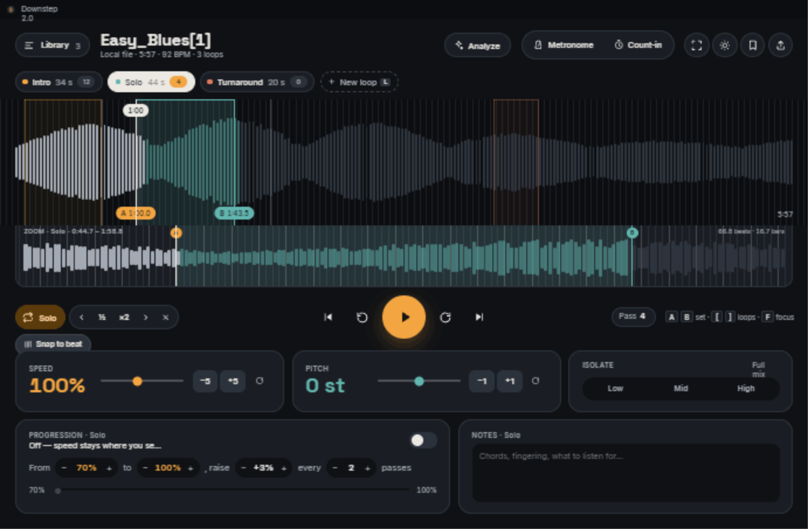
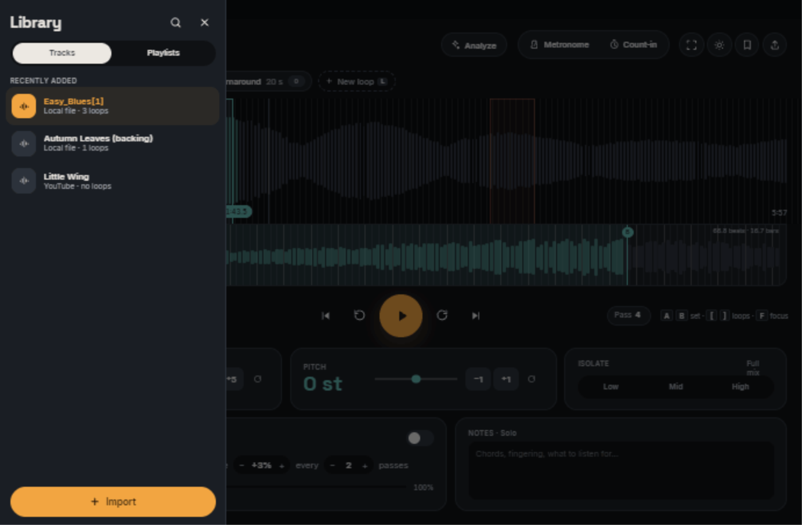
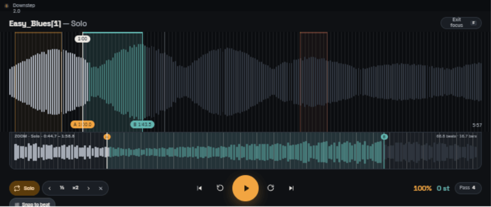

# Downstep 2.0 — Player redesign handoff

Prototype of the redesigned Downstep player (practice / transcription: speed, pitch, loops).
Built from the current app's theme (`Color.kt`, `Type.kt`), fonts and app icon in `EvolveHQ/downstep`.

```
handoff/
  README.md                 this document
  prototype/                clickable prototype — open "Downstep Player v3.dc.html" in a browser
  screenshots/              every section and behaviour, 1280px layout, dark + light
  assets/
    (fonts)                 Inter 400/500/600, Space Grotesk 500/700 (OFL): not copied here, they live once in
                            shared-ui/src/commonMain/composeResources/font/ (the prototype loads them from there)
    icons/                  downstep-app-icon.svg (replaces the Java coffee-cup in the title bar)
    palette.json            all colours, type, radii and control sizes used
```

The prototype simulates audio: the playhead advances in real time at the chosen speed, loops wrap, passes count,
progression ramps the speed. Nothing is actually heard. Isolate, Metronome, Count‑in, Save preset, Export are visual states only.

---

## 1. Design principles

1. **The waveform is the instrument.** It spans the full window width with no card around it; everything else is
   secondary and sits above or below it. A second, zoomed waveform shows the active loop at sub‑beat precision.
2. **Loops are first‑class objects.** A track owns many named loops. They are visible everywhere at once — as colour
   regions on the waveform, as chips above it, and as the subject of the tools below it.
3. **Library is a drawer, not a sidebar.** It appears on demand and never takes width from the waveform.
4. **Actions are labelled.** Every top action is an icon *plus* a word (Metronome, Count‑in, Analyze) or a
   standard, well‑known icon with a tooltip (theme, focus, save, export). No ambiguous icon rows.
5. **Two accents only.** Amber = speed / loop start (A) / primary action. Teal = pitch / loop end (B) / isolate.
   Everything else is a neutral surface scale.
6. **Pills for state, cards for settings.** Toggles and chips are 999px pills; settings groups are 20px‑radius cards.

### Colour (see `assets/palette.json`)

| Role | Dark | Light |
|---|---|---|
| Background / waveform ground | `#0F1114` / `#0B0D10` | `#FAF6F0` / `#F4EEE5` |
| Surface 1‑4 (cards → hover → borders → strongest) | `#1A1E24 #20252C #2C323B #3B424C` | `#EEE7DC #E6DED1 #DDD4C6 #D3CABD` |
| Text / secondary text | `#ECE8E2` / `#A4AAB4` | `#1C1B19` / `#5E5A54` |
| Amber (speed, A, play, loop‑on) | `#F2A541` on `#2A1800` | `#A86400` on white |
| Teal (pitch, B, isolate) | `#62B6B0` on `#00201E` | `#2D7C77` on white |
| Loop colours (cycled by loop id) | amber, teal, coral `#E07A5F`, olive `#B8C46A` | `#A86400 #2D7C77 #B0533A #3F7A5A` |

Light mode is the existing Downstep light palette; dark is the existing dark palette. The theme toggle (sun/moon,
header) persists in `localStorage`.

### Type

- **Space Grotesk 700** — track title (26px), large read‑outs (speed 34px, pitch 34px, focus read‑outs 18px), drawer title.
- **Inter 400/500/600** — all UI text. 13px controls, 12px meta, 11px uppercase section labels with 0.6px tracking.
- Tabular numerals everywhere (`font-feature-settings: 'tnum'`) so timecodes and percentages do not jitter.

### Spacing & sizes

24px page gutter. Header controls 40px tall; chips 34px; waveform 200px (260px in focus); zoom strip 96px;
play 68px; transport buttons 44px; loop‑tool buttons 30px. Minimum hit target in the transport is 44px.

---

## 2. Anatomy, top to bottom



### 2.1 Title bar
OS‑style strip with the real Downstep icon (`assets/icons/downstep-app-icon.svg`) and version.

### 2.2 Header
- **Library** pill (left) with track count → opens the drawer.
- **Track title** + meta line: source · duration · detected BPM · loop count.
- **Analyze** pill → section detection (see §4.8). Label becomes *Analyzing…* then *Re‑analyze*.
- **Metronome / Count‑in** segmented pill; each is an independent amber‑filled toggle.
- Icon buttons: **Focus** (⤢), **Theme** (☀/☾), **Save preset** (bookmark), **Export** (↑; full track, loops or
  both, see §7.3).

### 2.3 Loop chips strip
One chip per loop, in time order: colour dot · name · length · **pass badge**. The active chip is inverted
(light fill on dark, dark fill on light) with an amber pass badge. Suggested loops from Analyze appear as
dashed amber chips with ✓ / ✕. The strip ends with a dashed **+ New loop `L`** chip. Scrolls horizontally when long.
A double click on a chip renames the loop in place (see §7.2).

### 2.4 Overview waveform (full width)
- Bars: played = light grey, unplayed = dark grey; inside the active loop they take the loop colour (played solid, unplayed 50%).
- Every loop draws a tinted region, a 7px rounded **top bar** (a grab handle with three grip dots; it grows to 11px
  and turns opaque under the mouse or in a drag) and 1px edge lines in its colour; the active one is brighter.
  Any loop's bar and edges can be dragged (§3, §7.2).
- No bar or beat lines: loop edges are free (Snap to beat was removed after 2.0, see §7.1).
- **A / B pills** at the bottom with timecodes to 0.1s; a faint bracket shows the zoom window.
- **Playhead**: 2px line with a glow and a floating timecode pill at the top, just under the loops' top bars.
- Dashed amber outlines + labels for Analyze suggestions.

### 2.5 Zoom strip
Attached under the overview, inset to the gutter. Shows the active loop plus ~35% padding each side (minimum 4 beats).
No beat lines. Header text: `ZOOM · <loop> · <window from–to>` and `<n> beats · <n> bars` for the loop
(the length in seconds without a BPM). A/B lines are draggable here, freely, as on the overview. A drag on the
overview (an edge or the whole loop) is drawn here live as well; the window re‑frames when the drag is dropped.

### 2.6 Transport row
- **Left:** loop toggle pill (amber when looping, shows the active loop name or *Loop off*) · active‑loop tool
  group (◀ nudge · ½ · ×2 · nudge ▶ · ✕ delete). (The *Snap to beat* toggle that followed it was removed, §7.1.)
- **Centre:** ⏮ to start · ↺ −5s · **Play/Pause** · ↻ +5s · ⏭ next loop.
- **Right:** **Pass** counter pill (`Pass 4 · +3% in 2` while progression is on) · keyboard hints (`A B set · [ ] loops · F focus`).
  In focus mode the hints are replaced by large speed and pitch read‑outs.

### 2.7 Speed · Pitch · Isolate cards
- **Speed** 25–200%, slider, −5/+5, reset. Amber read‑out.
- **Pitch** −12…+12 semitones, slider, −1/+1, reset. Teal read‑out.
- **Isolate** Low / Mid / High solo toggles (teal when on). Label reads *Full mix* or e.g. *Low + Mid only*.

### 2.8 Progression · Notes cards (per active loop)
- **Progression**: on/off switch; one sentence of pill‑steppers — *From 70% to 100%, raise +3% every 2 passes*;
  status line (*Off — speed stays where you set it* / *Now 76% · next +3% in 1 pass* / *At target — 100%*);
  a thin from→to progress track.
- **Notes**: free text saved with the loop (chords, fingering, what to listen for).

### 2.9 Library drawer
360px panel sliding over the left edge with a scrim. Title, search, close; Tracks / Playlists segmented pill;
list with artwork tile, title, meta (source · loop count); the current track is highlighted amber. Full‑width amber **Import** button at the bottom.



---

## 3. Interaction model

### Pointer
| Target | Gesture | Result |
|---|---|---|
| Overview waveform | click inside the looping loop | seek there, keep looping |
| Overview waveform | click anywhere else (another loop's body too) | Loop off, seek there; playing or paused stays as it was |
| Loop top bar (overview) | click (no drag) | play this loop: active, Loop on, from its A, playing (on the loop already being looped: seek within it, playing or paused as it was) |
| Loop top bar (overview) | drag | move the whole loop, keeping its length, clamped to the track; a loop that is not active becomes active |
| Zoom waveform | click | seek playhead |
| A or B line (either waveform; any loop on the overview) | drag | move loop edge freely (no beat grid); A can't cross B (min 0.5% apart, at least 1 s); a loop that is not active becomes active |
| Loop chip | click | make active, jump playhead to its start, loop on |
| Loop chip | double‑click | rename in place: Enter or clicking away saves, Esc cancels, an empty name keeps the old one |
| Suggested chip ✓ / ✕ | click | accept (becomes a real loop, active) / dismiss |
| ½ / ×2 | click | halve / double the loop keeping A fixed |
| ◀ ▶ nudge | click | shift the whole loop by a fixed 1 s of track time |
| ✕ in tool group | click | delete active loop; the first remaining loop becomes active |
| Progression steppers | click | ±5% (from/to), ±1% (step), ±1 (every) |

### Keyboard (ignored while typing: Notes, BPM, a loop's name, search)
| Key | Action |
|---|---|
| `Space` | play / pause |
| `L` | new loop starting exactly at the playhead (8 beats long with a BPM, else 8 s) |
| `Shift+L` | loop on / off |
| `A` / `B` | set active loop's start / end exactly at the playhead |
| `[` / `]` | previous / next loop (jumps to its start) |
| `←` / `→` | seek −5 s / +5 s |
| `F` | focus mode on / off |
| `Esc` | close drawer, exit focus |

### State feedback
- Active loop: inverted chip, brighter region, visible A/B pills, tool group enabled, zoom strip follows it.
- Playing: play icon ↔ pause icon; playhead and timecode pill move; passes tick up at every wrap.
- Toggles (Metronome, Count‑in, Loop, Isolate, Progression) fill with their accent when on.
- Suggestions are always dashed until accepted — the app never commits loops on the user's behalf.

---

## 4. Functionalities

### 4.1 Multiple named loops
Each loop = `{ name, start, end, passes, notes }`, stored with the track, sorted by start time, coloured by id.
Any number per track. One is *active*: it is the one that wraps playback, gets edited, zoomed and counted.

### 4.2 Looping
When *Loop* is on and the playhead reaches B, it jumps to A and the loop's **pass counter** increments.
*Loop off* keeps the loop defined but plays through.

### 4.3 Speed and pitch
Independent; speed 25–200% in 5% steps, pitch ±12 semitones. The transport simulation advances in proportion to speed.

### 4.4 Snap to beat (removed after 2.0)
The prototype quantised A/B set/drag, new loops and nudges to a beat grid and drew bar lines while *Snap to beat*
was on. The app no longer has it: loop edges are always free, nudges are a fixed 1 s and no grid lines are drawn.
The BPM still sets the length of a new loop (8 beats), the zoom padding (4 beats) and the beat count. See §7.1.

### 4.5 Zoom strip
Derived view, no separate zoom control: window = active loop ± max(35% of its length, 4 beats). Changing the loop
re‑frames it automatically.

### 4.6 Pass counter and Progression
A pass is counted every time the active loop wraps during playback (no judgement of quality — see note below).
Progression, when on, sets speed to *From* and raises it by *Step* every *Every* passes until *Target*; the
transport pill shows *+3% in N*, and the card's status/progress bar reflect where you are.
> Recommendation for the real app: reset the pass counter if the user intervenes mid‑pass (seek, A/B change, speed/pitch change, pause) so "passes" means uninterrupted passes.

### 4.7 Isolate
Band solo (Low / Mid / High) — any combination; none selected = full mix. Visual only in the prototype.

### 4.8 Analyze (suggested loops)
Simulates ~1.6s of analysis then proposes sections (Verse 1, Chorus, Bridge) as dashed chips and dashed outlines
on the waveform. Accept turns one into a normal loop and makes it active; dismiss removes it. *Re‑analyze* repeats.
Intended backend: section/beat detection model; an LLM only for naming. Never auto‑commit.

### 4.9 Focus mode
Hides header, chips strip, Speed/Pitch/Isolate and Progression/Notes. Keeps: compact title + *Exit focus*,
taller waveform (260px), zoom strip, transport with loop tools, big speed/pitch read‑outs and pass pill.



### 4.10 Notes
Per‑loop free text, persisted with the loop, shown for the active loop.

### 4.11 Library
Tracks and playlists in a drawer; selecting a track loads it (loops are per track), closes the drawer. Import at the bottom.

### 4.12 Theme
Dark (default) and light, toggled from the header, persisted.

---

## 5. Screenshot index

| File | What it shows |
|---|---|
| `01-player-dark.png` | Default state, dark, Solo loop active |
| `02-player-light.png` | Same in light theme |
| `03-focus-mode.png` | Focus mode |
| `04-player-after-focus.png` | Back to full layout |
| `05-library-tracks.png` | Library drawer, Tracks tab |
| `06-library-playlists.png` | Library drawer, Playlists tab |
| `07-analyze-running.png` | Analyze in progress (header label *Analyzing…*) |
| `08-analyze-suggestions.png` | Three dashed suggestions on chips and waveform |
| `09-suggestion-accepted.png` | Chorus accepted → real loop; Verse dismissed |
| `10-progression-isolate-metronome.png` | Progression on (speed snapped to 70%), Low isolated, Metronome + Count‑in on |
| `11-playing-passes-ramp.png` | Playing; pause icon, pass pill with ramp hint, moved playhead |
| `12-loop-off-snap-off.png` | Loop off, Snap off (no grid lines). Predates §7.1: the app has no Snap toggle any more |
| `13-new-loop-added.png` | `L` pressed → "Loop 5" (8 beats) created at playhead and active |
| `14-loop-halved.png` | ½ applied → 4 beats, zoom re‑framed |

---

## 6. Not in scope / open
- Spotify / Apple Music import (DRM prevents time‑stretch; dropped by decision).
- Real audio engine, EQ, metronome click, count‑in bars, export formats, preset contents.
- Mic‑based "clean pass" scoring.
- Responsive behaviour below ~1000px (cards would need to stack).

---

## 7. Changes after 2.0

What the app does differently from the sections above since the 2.0 handoff. The prototype and the screenshots are
kept as they were (they are the record of the design); where they disagree with this section, this section wins.

### 7.1 Snap to beat removed, play icon centred

**Snap to beat is gone**, with its toggle, its tooltip and its per‑track setting:
- A/B set (`A` / `B`), A/B drag on both waveforms, `L`, ½ and ×2 are free: positions are kept exactly where the
  playhead or the pointer is, never rounded to a beat. A still can't cross B (min 0.5% apart, at least 1 s).
- **◀ ▶ nudge moves the loop by a fixed 1 s of track time** (`LoopMath.NUDGE_SECONDS`), whatever the BPM, the speed
  or the track length: finer than the ±5 s seek, and the same step every time. Tooltips say "1 s".
- No bar lines on the overview and no beat lines on the zoom strip: the grid was anchored at 0 s with no
  downbeat, so on most songs it was off the real beats.
- The BPM is kept: it still sets the length of a new loop (8 beats; 8 s without one), the zoom padding (4 beats) and
  the `<n> beats · <n> bars` header, and it is the tempo of the metronome and count‑in.
- Storage: database version 3 drops `track_practice_state.snap_to_beat` (the table is rebuilt, which works on every
  SQLite) and adds the columns later features use (`eq_curve`, `detected_bpm`, `beat_offset_seconds`,
  `tempo_analysis_version`, and `practice_presets.eq_curve`). Backups no longer write `snapToBeat`; older backups
  that have it still restore (the key is ignored).

**The play icon is optically centred** in the round Play button (68 dp, 28 dp icon), in both themes and in focus
mode. The triangle's centroid, not its bounding box, now sits on the button's centre: `ic_h_play` is
`M8.3333 5v14l11-7z` (was `M10.5 5v14l11-7z`), so its vertices' mean is (12, 12) in the 24‑unit viewport. Before, the
centroid was 2.17 units (2.5 dp) right of centre; the bounding box now leans 1.83 units right, which is the optical
compensation. `PlayerRenderTest` measures the rendered icon's ink centroid against the button in the dark, light
and focus renders (within 0.6 dp; it measured 2.52 dp off before the change).

### 7.2 Loops edited on the overview, renamed in their chip

**Every loop on the overview is directly editable**, not only the active one:
- Each loop has a **top bar** (7px, rounded, three grip dots) instead of the 3px rule. Its grab zone is the top 16px
  of the waveform over the loop. Under the mouse the bar grows to 11px and turns opaque, and the cursor becomes a
  move cursor; over an edge (8px each side, any height) it is a horizontal‑resize cursor; elsewhere the crosshair.
- **Dragging the top bar moves the whole loop** by the pointer's travel, keeping its length; it stops at the start
  and end of the track. **Dragging an edge resizes** it; A can't cross B (the usual minimum length).
- Grabbing a loop that is not active makes it active as the drag starts, where the playhead is and with Loop on or
  off as it was. With Loop on the engine then loops the grabbed loop, so a playhead outside it goes to its A: you
  hear the loop you are editing. The zoom strip follows it and draws the drag live; its window re‑frames on drop.
- Where loops overlap, the active one is grabbed first, then the shortest; on a loop too narrow for a bar and two
  edges, the middle third is the bar.
- The drag is drawn locally and committed once on release, through the same use case as the A/B keys; the loop is
  saved at once and the practice state (the engine's region) by the debounced auto‑save.

**Click or drag**: a press that travels more than 4 dp sideways (a finger: the platform's touch slop) is a drag;
less is a click. On the overview a click means:
- inside the loop being looped: seek there, keep looping;
- anywhere else, including another loop's body below its top bar: **Loop off** and seek there (the loop stays
  selected); playback goes on if it was playing and stays paused if it was paused;
- on a loop's **top bar**: *play this loop*: it becomes active, Loop on, the playhead jumps to its A and playback
  starts (also when paused). On the loop that is already being looped it is a click inside it: seek there, and
  playing or paused stays as it was (when paused, only another loop's bar starts playback);
- on an edge of the active loop: a seek kept inside the loop (a click just outside B does not turn the loop off).

**Rename in place**: a double click on a loop chip (or *Rename* in its menu) turns the name into a text field with
the name selected. Enter or clicking away saves (trimmed, at most 40 characters), Esc cancels, and an empty or
unchanged name keeps the old one. The first click of the double click still selects the loop. While the field has
the focus the window's shortcuts are off, so Space, `L`, `A`, `B`, `F` and Esc go to the field. The rename dialog is
gone.

### 7.3 Export: full track, loops or both

The header's **Export** icon opens an options dialog before anything renders: **Full track** (the default, and
the only choice on a track without loops), **Loops, one file each** or **Full track and loops**. Each row says how
many files it writes; the loop rows are disabled with "This track has no loops yet" when there are none. The last
choice is offered again until the app quits.
- **Files.** All MP3, as before. The full track keeps its name, `<track> <speed>%[ ±<n>st].mp3`. Each loop is
  `<track> - <nn> <loop name>.mp3`: `nn` is the loop's place in the chip strip's order (by start), 1-based, with
  two digits (three past 99 loops), so a folder sorted by name lists the loops in musical order and two loops with
  the same name never collide. Names are made safe for Windows, macOS and Linux (`\ / : * ? " < > |` and control
  characters become `_`, line breaks and runs of spaces become one space, trimmed, no leading dot (a hidden file)
  and no trailing dot, the title capped
  at 80 characters and the loop name at 40), and a name that still repeats another, ignoring case, gets " (2)".
- **Sound.** A loop file is its A→B slice with exactly the full export's processing: speed, pitch, L/R mix, EQ
  curve and preamp. It lasts (B − A) / speed, starts with the player's 10 ms fade-in and ends with a 10 ms fade-out,
  so the cut never clicks. The engine renders every file of the batch from the one decoded buffer already in
  memory (`sd_export_begin_range`): nothing is decoded again.
- **Not exported, by decision:** the metronome, the count-in and Isolate. They are practice aids, not part of the
  music: a click or a count-in baked into a file cannot be taken out again, and a count-in would move A away from
  the start of a loop file. The dialog says so.
- **Progress and cancel.** One banner for the whole batch ("Exporting 4 files to MP3… 42%") with one bar, weighted by
  each file's length so it moves evenly from the first file to the last, and one Cancel. Cancelling, or any failure,
  deletes every file of the batch, including a file cut short by a failed write (a full disk): it is all or nothing.
- **Result.** One file: as before, *Save…* (a save-as dialog) and *Share* (shows it in the file manager). Several:
  the dialog lists the first five names, and *Save to folder…* opens a folder picker; every file is copied there,
  next to the others, and a file already in that folder is never replaced (the copy gets " (2)"). *Share* shows the
  batch in the file manager.
